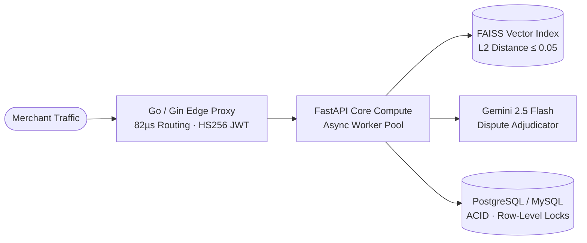

# Harsh Kumar Singh (HKS)
### Systems, Backend & Applied AI Infrastructure Engineer

  
  
  

  
  
  
  

    
  
  
  

---

## 30-Second Pitch

> I am a **Systems & Backend Engineer** with a strong foundation in **Competitive Programming** and **Distributed AI Infrastructure**. Rather than building high-level wrapper apps, I engineer low-latency backend systems from first principles—combining **Go (Gin) concurrent microservices**, **ACID-compliant transactional databases (`FOR UPDATE` row-level locking)**, and **FAISS vector similarity pipelines** backed by rigorous $O(n \log n)$ algorithmic optimization in **C++**.

---

## TL;DR for Recruiters

| Dimension | Highlights |
| :--- | :--- |
| **Target Roles** | **Software Development Engineer (SDE)** · **Backend & Distributed Systems** · **Applied AI Infrastructure** |
| **Core Architecture** | Sub-millisecond Go (Gin) proxies ($82\mu s$ overhead) · MySQL `START TRANSACTION` & row-level locking · FAISS vector search ($L_2 \le 0.05$) · FastAPI & Docker |
| **Algorithmic Pedigree** | [**Codeforces Specialist (1436)**](https://codeforces.com/profile/itsmeharshkumarsingh) · [**LeetCode Knight (2031)**](https://leetcode.com/u/itsmeharshkumarsingh/) ·  [**CodeChef 3-Star (1635)**](https://www.codechef.com/users/itsmehks) · **ICPC Prelims Global Rank 955** |
| **Global Recognition** | **ThAT Fellow '26 (Top 100 Globally)** — AE Global Summit 2026 (London), collaborating with researchers from Google DeepMind, Microsoft, NVIDIA & Oxford |
| **Experience** | **Problem Setter Intern @ AskSenior** (Authoring CP problems, test cases & editorials) · [**Technical Creator**](https://www.youtube.com/@itsmeharshkumarsingh) (25+ C++ & OA optimization breakdowns) |
| **Education** | **B.Tech in Information Technology**, National Institute of Technology (NIT) Raipur (2024–2028 · **CGPA: 8.38/10.0**) |
| **Direct Contact** | [harshkumarsinghofficial@gmail.com](mailto:harshkumarsinghofficial@gmail.com) · [LinkedIn](https://www.linkedin.com/in/itsmeharshkumarsingh/) · +91-9631462130 |

---

## 🏗️ Flagship Systems & Architecture

| System | Architecture & Engineering Constraints | Tech Stack |
| :--- | :--- | :--- |
| [**PayPal Merchant AI Gateway & Dispute Adjudicator**](https://github.com/itsmeharshkumarsingh/fintech-polyglot-platform) | • Decoupled ingress proxy routing from core compute for PayPal Sandbox v2 orders. • Achieved **$82\mu s$ routing overhead** via concurrent Go (Gin) goroutines & stateless **HS256 JWT** auth. • Engineered an async retrieval pipeline using **FAISS vector search ($L_2 \le 0.05$)** and **Gemini 2.5 Flash** to query historical fraud precedents. | `Go` `Gin` `Python` `FastAPI` `FAISS` `Gemini 2.5 Flash` `PostgreSQL` `Docker` |
| [**HKS Bank & Co.**](https://github.com/itsmeharshkumarsingh/HKS-Bank-Co) *(Enterprise SPA Banking)* | • High-frequency financial portal guaranteeing strict **ACID compliance** during system failures via **MySQL Stored Procedures** and `START TRANSACTION` protocols. • Eliminated multi-user race conditions during concurrent fund transfers using **`FOR UPDATE` row-level database locking** and dynamic REST data isolation. | `Node.js` `Express.js` `MySQL` `JavaScript (ES6+)` `HTML5/CSS3` `Chart.js` |
| [**SegDPVisualizer**](https://github.com/itsmeharshkumarsingh/Flat-Subsequence-Segment-Tree-DPVisualizer) *(Algorithmic Engine)* | • Interactive visualizer demonstrating how **Dynamic Programming**, **Coordinate Compression**, and a **Segment Tree** optimize an $O(n^2)$ recurrence down to **$O(n \log n)$**. • Features real-time, step-by-step **SVG rendering** of range queries and point updates for the Longest Flat Subsequence problem. | `JavaScript (ES6+)` `HTML5` `TailwindCSS` `SVG` |

---

## 📌 Pinned Repositories

  
  

  

---

## 🏆 Honors & Competitive Milestones

- **ThAT Fellow '26 (Top 100 Globally):** Selected by *Thinking About Thinking* for the **AE Global Summit 2026 (London)**, collaborating with researchers from **Google DeepMind, Microsoft, NVIDIA, and Oxford**.
- **National Semifinalist — Flipkart GRiD 8.0:** Advanced among **1,65,729+ registrations** nationwide in a multi-stage software engineering crucible.
- **Winner — CodeRush '25:** 1st Place at the national-level competitive programming contest during **Infotsav '25 at ABV-IIITM Gwalior**.
- **Global Rank 955 — ICPC 2025–26 Prelims:** Led team to secure AC solutions across complex algorithmic challenges.
- **100th Percentiler (Physics) — JEE Mains 2024:** Secured a perfect 100 percentile in Physics (**98.82 Percentile Overall**).

---

## Experience & Technical Leadership

- **Problem Setter Intern @ AskSenior** *(Sep 2026 – Mar 2027)*
  - Authored and curated original competitive programming problems, rigorous corner-case test suites, and algorithmic breakdowns using **Obsidian**.
- [**Technical Content Creator @ YouTube (`@itsmeharshkumarsingh`)**](https://www.youtube.com/@itsmeharshkumarsingh) *(Aug 2025 – Present)*
  - Produced **25+ deep-dive video breakdowns** analyzing C++ execution efficiency ($10^8\text{ ops/sec}$), bitwise optimizations, and advanced **DP, Graphs, and Segment Tree** paradigms for Tier-1 OA preparation.

---

## 🛠️ Tech Arsenal

  

  
  
  
  
  
  

---

## 📊 GitHub Telemetry

  

